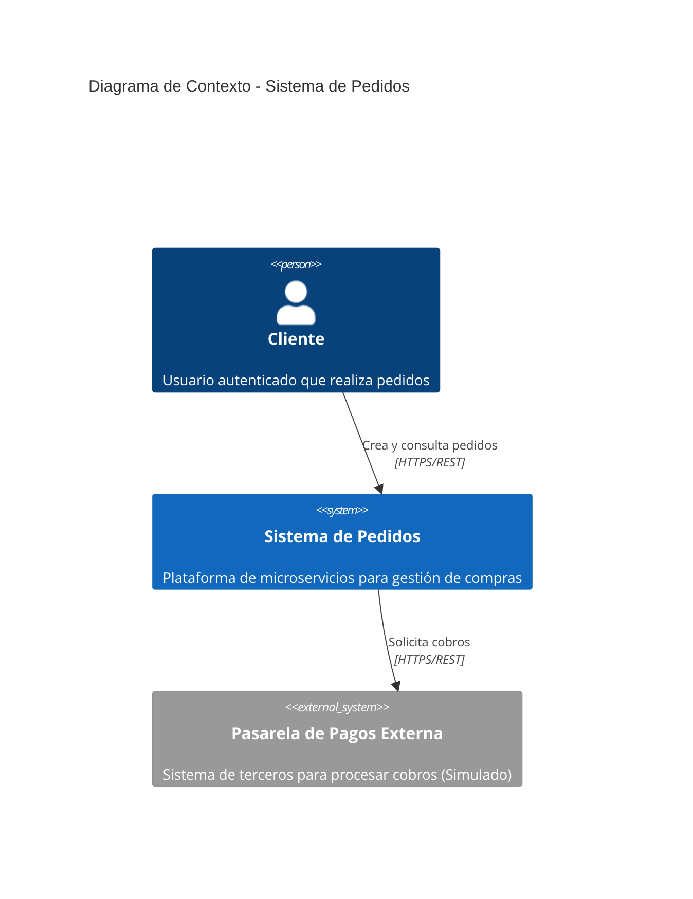
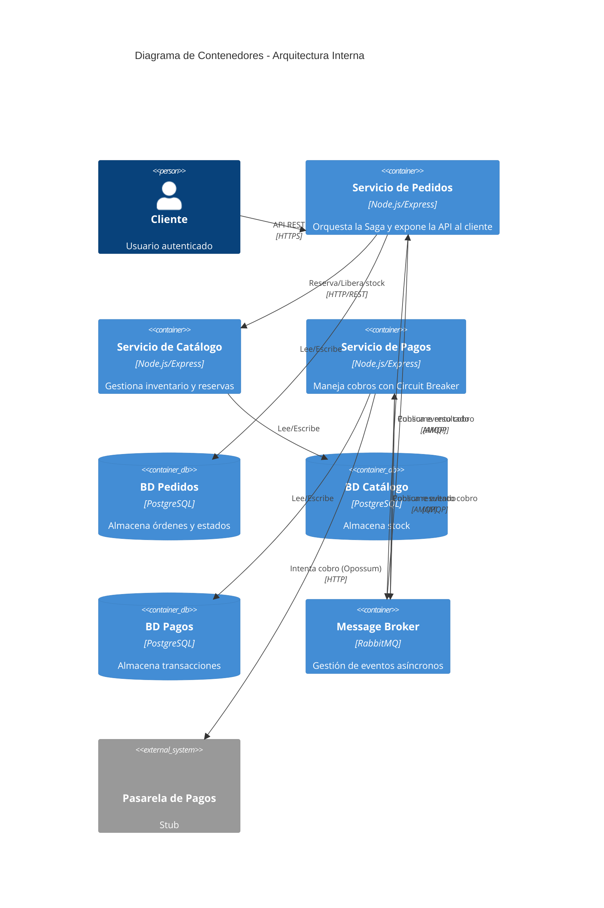
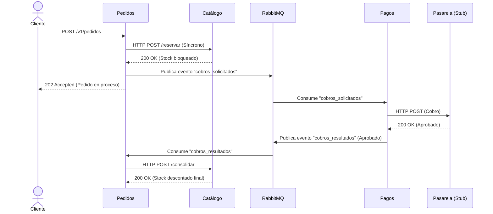
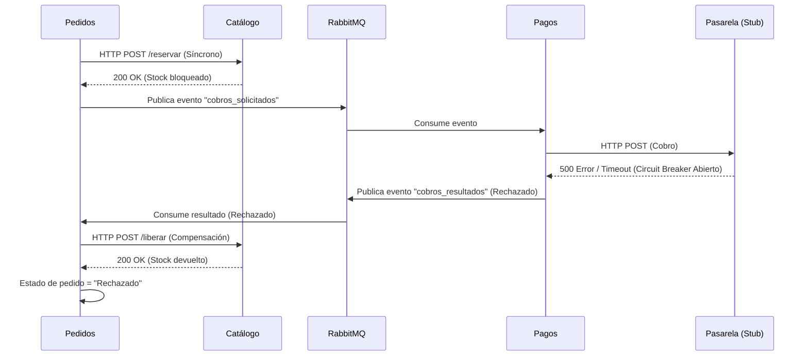

# Documentación Visual de Arquitectura

## 1. Diagrama C4 Nivel 1: Contexto del Sistema

## 2. Diagrama C4 Nivel 2: Contenedores

## 3. Secuencia de la Saga: Camino Feliz (Consolidación)

## 4. Secuencia de la Saga: Camino de Compensación (Fallo pasarela)

